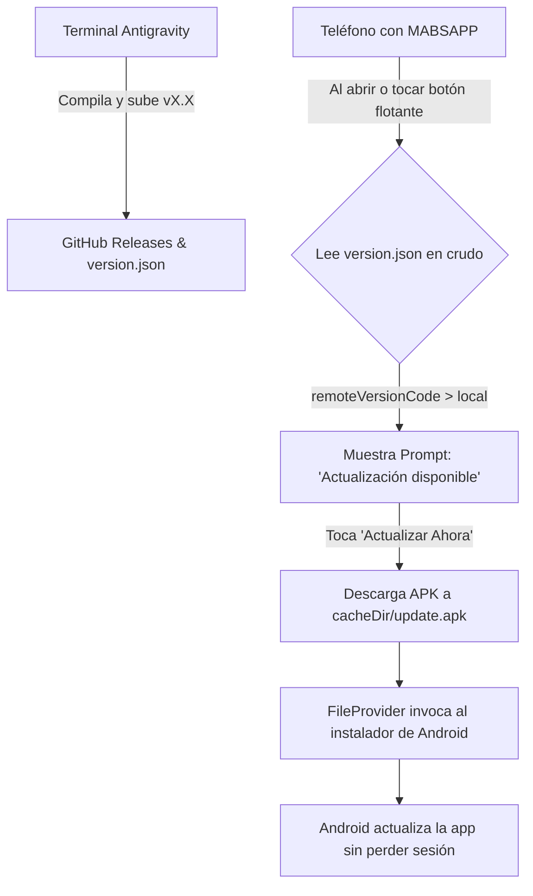

# 🧠 AI BRAIN & BITÁCORA DEL PROYECTO: MABSAPP

> **Documento Maestro de Arquitectura, Historial, Claves y Configuración**  
> *Creado para persistencia total de contexto. Cualquier agente o desarrollador puede retomar el proyecto desde aquí.*

---

## 📌 1. Ficha Técnica del Proyecto

| Parámetro | Valor |
|---|---|
| **Nombre de la App** | **MABSAPP** |
| **Package ID** | `com.mabsapp.whatsappweb` |
| **Directorio Local** | `C:\Users\pedro\Documents\VIBE CODING - MY APPS\MiWhatsAppWeb` |
| **Repositorio GitHub** | [https://github.com/MisaelOrtizDR/MABSAPP](https://github.com/MisaelOrtizDR/MABSAPP) |
| **Usuario GitHub** | `MisaelOrtizDR` |
| **Versión Actual** | **v1.8** (`versionCode: 9`) |
| **Tecnología** | Android Nativo (Kotlin) + Gradle + Chromium WebView |
| **Compilador Target** | `compileSdk 34`, `minSdk 24` (Android 7.0 a 15+) |

---

## 🛠️ 2. Entorno y Herramientas Instaladas en el Sistema

Todas las herramientas fueron instaladas y configuradas automáticamente en el sistema operativo Windows:

| Herramienta | Ruta de Instalación | Variable / Configuración |
|---|---|---|
| **Java JDK 17 LTS** | `C:\Program Files\Microsoft\jdk-17.0.20.101-hotspot` | `JAVA_HOME` persistida en variables de usuario |
| **Android SDK** | `C:\Users\pedro\AppData\Local\Android\Sdk` | `ANDROID_HOME` y `ANDROID_SDK_ROOT` |
| **SDK Build Tools** | `...\Android\Sdk\build-tools\34.0.0` | Incluye `apksigner.bat` y `zipalign.exe` |
| **SDK Platforms** | `...\Android\Sdk\platforms\android-34` | Android 14 / API 34 |
| **Command Line Tools**| `...\Android\Sdk\cmdline-tools\latest\bin` | `sdkmanager.bat` |
| **Gradle** | `C:\Users\pedro\AppData\Local\Gradle\gradle-8.5` | Gradle Wrapper `8.5` integrado en el repo |
| **MinGit (Portable)** | `C:\Users\pedro\AppData\Local\Programs\Git\cmd` | `git.exe` agregado al PATH de usuario |
| **GitHub CLI (`gh`)**| `C:\Program Files\GitHub CLI` | Autenticado con la cuenta `MisaelOrtizDR` |

---

## 🔐 3. Certificado Criptográfico y Llaves de Firma (Keystore)

La app está certificada y firmada oficialmente para evitar bloqueos de Google Play Protect y poder actualizarse *in-place*:

* **Archivo Keystore:** `MiWhatsAppWeb\mabsapp-release.jks`
* **Alias:** `mabsapp`
* **Contraseñas:** se leen desde `keystore.properties` (archivo local, ignorado por Git) o desde las variables de entorno `MABSAPP_STORE_PASSWORD` / `MABSAPP_KEY_PASSWORD`. **No se escriben en el repositorio.**
* **Algoritmo:** RSA 2048-bit (SHA256withRSA)
* **Validez:** 10,000 días (~27 años)
* **Distinguished Name (DName):** `CN=MABSAPP, OU=Mobile Development, O=MABSAPP Inc, L=Santo Domingo, ST=DN, C=DO`
* **Esquemas de Firma:** APK Signature Scheme **v1** y **v2** (sellado con `apksigner`).

> ⚠️ **Aviso de seguridad:** el keystore y las contraseñas estuvieron expuestos en la historia pública del repo. Para una seguridad total habría que rotar la clave, lo que obliga a reinstalar la app (rompe la actualización in-place). Mientras tanto, considera esa clave comprometida y no la reutilices en otros proyectos.

---

## 🚀 4. Arquitectura de Auto-Actualización OTA (*Over-The-Air*)

El teléfono actualiza la app a sí mismo sin necesidad de cables, Drive ni tiendas de aplicaciones:



* **Manifiesto Remoto:** `https://raw.githubusercontent.com/MisaelOrtizDR/MABSAPP/main/version.json`
* **FileProvider Authority:** `com.mabsapp.whatsappweb.fileprovider`
* **Ruta de Descargas:** Cache interna (`res/xml/file_paths.xml`)
* **Permiso Especial:** `android.permission.REQUEST_INSTALL_PACKAGES`

---

## 🎨 5. Icono Oficial de la Aplicación

El logo neon (letra **M** azul cian con **A** morada) fue procesado y adaptado en todas las resoluciones oficiales de Android:

* `res/mipmap-mdpi/`: 48x48 px
* `res/mipmap-hdpi/`: 72x72 px
* `res/mipmap-xhdpi/`: 96x96 px
* `res/mipmap-xxhdpi/`: 144x144 px
* `res/mipmap-xxxhdpi/`: 192x192 px
* `res/drawable/mabsapp_logo.png`: 1024x1024 px (alta resolución)
* Formatos generados: Tanto cuadrado (`ic_launcher.png`) como redondeado (`ic_launcher_round.png`) para compatibilidad con OneUI, MIUI, Pixel Launcher, etc.

---

## 📜 6. Historial Completo de Versiones y Aprendizajes

### **v1.0 (code 1) - Prototipo Inicial**
- Configuración inicial de Android WebView a pantalla completa.
- User-Agent Chrome Windows para burlar la detección móvil de WhatsApp Web.
- Permisos básicos (Internet, Audio, Cámara).

### **v1.1 (code 2) - Escala y Motor OTA**
- Integración de arquitectura de actualización OTA con GitHub.
- Cálculo de escala dinámico (`DisplayMetrics`).
- Desbloqueo de gestos de zoom con dos dedos (*pinch-to-zoom*).

### **v1.1 Release Security - Blindaje Criptográfico**
- Creación del Keystore RSA de 2048 bits para eliminar alertas de Google Play Protect.
- Configuración de `signingConfigs` en Gradle.
- Desactivación de `usesCleartextTraffic` y `allowBackup`.

### **v1.2 a v1.4 (codes 3-5) - El Reto de la Columna Única**
- *Problema descubierto:* WhatsApp Web es una Single Page Application en React con virtualized lists. 
- *Intento fallido:* Inyectar `display: none` o `width: 0` destruía los nodos del Virtual DOM de React, causando que la pantalla se montara una sobre otra o se fuera a negro.
- *Evolución:* Se probó detección por `footer` y captura de eventos de clic en `#pane-side`.

### **v1.5 (code 6) - Identidad de Marca**
- Procesamiento e integración del icono oficial en el instalador y la pantalla de inicio de Android.

### **v1.6 (code 7) - Análisis del Fallo de Carga**
- *Problema detectado:* Un temporizador recursivo (`setTimeout` cada 500ms) se ejecutaba mientras WhatsApp hacía el handshake de cifrado.
- *Consecuencia:* WhatsApp Web se quedaba congelado en la pantalla verde "End-to-end encrypted" y un dispatch de tecla `Escape` provocaba el molesto "scroll up solo".

### **v1.7 (code 8) - SOLUCIÓN DEFINITIVA Y ESTABLE**
- **User-Agent Moderno:** Actualizado a **Chrome 130** (`Chrome/130.0.0.0`), garantizando soporte pleno para los WebSockets y WebCrypto de WhatsApp.
- **Cero Temporizadores Invasivos:** Eliminados todos los `setInterval` y `setTimeout` que saturaban el motor V8.
- **CSS Puro con `:has(header)`:** Utiliza el selector nativo de Chromium `#main:has(header)`:
  - Cuando estás en la lista de chats: `#main` no tiene cabecera, así que `#side` ocupa el 100% de la pantalla.
  - Al tocar un chat: React monta `<header>` y automáticamente la conversación se expande a pantalla completa (`position: fixed; z-index: 9999`).
  - Al tocar volver: Se cierra el chat, el header desaparece y la lista se muestra de nuevo.
  - **Cero destrucción del DOM:** React mantiene vivos todos sus componentes sin colisiones.
- **Menú de Opciones en el Botón Flotante:** Al tocar el botón verde, el usuario dispone de:
  1. *Buscar actualización*
  2. *Recargar página*
  3. *Limpiar datos y reiniciar sesión* (limpia cookies y caché si la sesión llega a trabarse).

### **v1.8 (code 9) - UNA COLUMNA REAL + OTA BLINDADO**
- **Causa raíz de las dos columnas:** `useWideViewPort=true` + `loadWithOverviewMode=true` hacían que `100vw` midiera ~980 px (layout de escritorio), no el ancho del teléfono. La lista y la conversación convivían y había que desplazarse horizontalmente.
- **Solución:** viewport real del teléfono (`useWideViewPort=false`, `loadWithOverviewMode=false`, `width=device-width`), CSS que anula los `min-width` de escritorio y estados `mabs-list` / `mabs-chat` con `visibility` + posición fuera de pantalla. React conserva el DOM; no se destruyen nodos.
- **Detección robusta del chat:** `conversation-panel-wrapper`, caja de composición y header/footer. `MutationObserver` con `requestAnimationFrame` (sin timers ni polling).
- **Atrás:** se usa el botón nativo de WhatsApp o `Escape`; el botón se inyecta solo si WhatsApp no trae uno propio.
- **FAB oculto dentro del chat** para que no tape el botón de enviar.
- **OTA:** valida el APK descargado (paquete, versión y firma SHA-256), detecta HTML/descargas incompletas, reintenta la instalación al volver de "apps desconocidas" y consulta `version.json` con cache-buster.
- **Limpiar datos:** borra cookies, localStorage, IndexedDB, service workers y caché; espera la confirmación de la página antes de recargar.
- **Estabilidad/seguridad:** `onReceivedError`, `onRenderProcessGone`, limpieza del WebView, whitelist de dominios con límite de punto, permisos de cámara/micrófono validados por origen y sin `onReceivedSslError.proceed`.
- **Credenciales:** `app/build.gradle` ya no contiene contraseñas; se leen de `keystore.properties` (local) o variables de entorno.

---

## 🧰 7. Comandos de Operación Rápida para la Terminal

Para futuras compilaciones o actualizaciones:

```powershell
# 1. Configurar entorno en la sesión
$env:JAVA_HOME = "C:\Program Files\Microsoft\jdk-17.0.20.101-hotspot"
$env:ANDROID_HOME = "$env:LOCALAPPDATA\Android\Sdk"
$env:Path = "$env:JAVA_HOME\bin;$env:ANDROID_HOME\cmdline-tools\latest\bin;$env:ANDROID_HOME\platform-tools;$env:LOCALAPPDATA\Programs\Git\cmd;C:\Program Files\GitHub CLI;$env:Path"

# 2. Ir a la carpeta
cd "C:\Users\pedro\Documents\VIBE CODING - MY APPS\MiWhatsAppWeb"

# 2b. Credenciales de firma (solo la primera vez; NO se suben a Git)
# Crear keystore.properties con:
#   storePassword=...
#   keyPassword=...
#   keyAlias=mabsapp

# 3. Compilar APK Release firmado
.\gradlew.bat assembleRelease

# 4. Copiar APK a la raíz
Copy-Item "app\build\outputs\apk\release\app-release.apk" "MABSAPP.apk" -Force

# 5. Subir a GitHub y crear Release apuntando a main
git add .
git commit -m "Descripción de la mejora"
git push origin main
# Mantener master al día para que el código visible en GitHub no quede en v1.1
git push origin main:master
gh release create vX.X .\MABSAPP.apk --target main --title "MABSAPP vX.X" --notes "Notas de versión"
```

---

## 📱 8. Enlace Permanente de Descarga
El último ejecutable siempre se encuentra disponible públicamente en:
👉 **[Descargar Último APK (GitHub Releases)](https://github.com/MisaelOrtizDR/MABSAPP/releases/latest/download/MABSAPP.apk)**

---

## 🧩 9. Arquitectura de la Vista de Una Columna

- `MainActivity.configureWebView()` fija `useWideViewPort=false` y `loadWithOverviewMode=false`; el layout viewport es el ancho real del teléfono.
- `injectMobileLayout()` espera a que exista `#side` (MutationObserver, sin polling) y solo entonces inyecta el CSS.
- Estados en `<body>`:
  - `mabs-list`: `#side` ocupa `100vw - 52px` (barra lateral), `#main` oculto con `visibility:hidden` y fuera de pantalla.
  - `mabs-chat`: `#main` fijo a `100vw x 100dvh`, `#side` y la barra lateral ocultas.
- El estado se detecta con `conversation-panel-wrapper`, la caja de composición o `header + footer`.
- `window.mabsGoBack()` pulsa el botón nativo de WhatsApp o envía `Escape`.
- El FAB nativo se oculta dentro del chat (`onChatStateChanged`).

## ⚠️ 10. Limitaciones conocidas (no son bugs del layout)

- **Notificaciones en segundo plano:** un WebView no recibe Web Push como Chrome; WhatsApp Web puede no notificar con la app cerrada. Requeriría un servicio nativo/notificaciones, fuera del alcance de este wrapper.
- **Descargas `blob:`:** WhatsApp Web genera algunas descargas como `blob:`; el `DownloadListener` solo puede abrir descargas HTTP(S) en el navegador. Para soportarlas habría que añadir un puente JS → MediaStore.
- **Llamadas:** WhatsApp Web no soporta llamadas; la app no las añade.
- **Zoom:** bloqueado a propósito para mantener la experiencia de app nativa. Si se necesita, se puede reactivar `setSupportZoom(true)` y `user-scalable=yes`.
